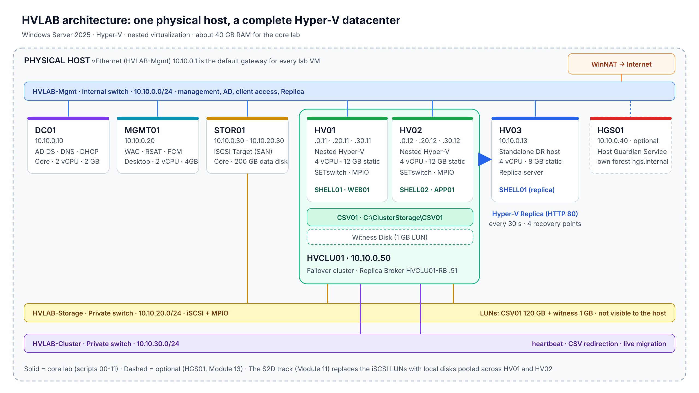
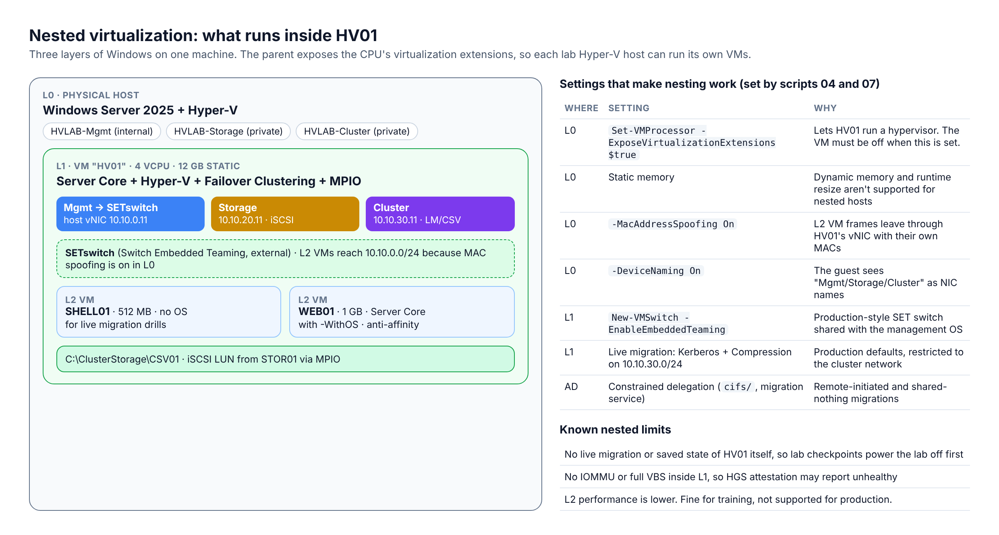
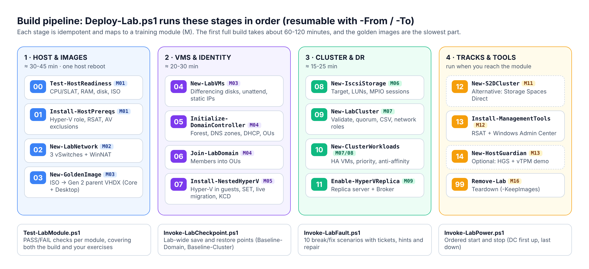
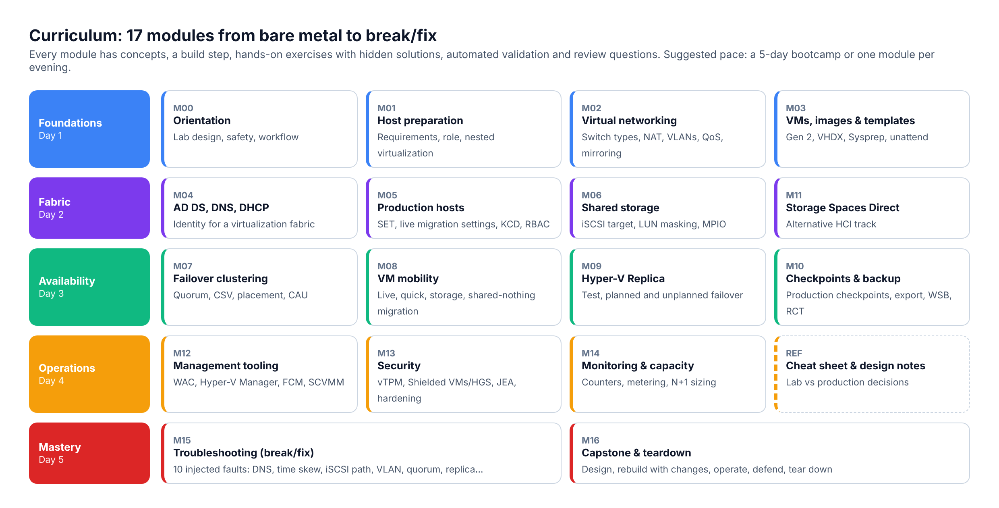

# Hyp_Lab: a hands-on Hyper-V training lab

Learn to **design, deploy, operate and troubleshoot Microsoft Hyper-V** the way it is done in production, on a single machine.

Hyp_Lab builds a small but realistic datacenter with PowerShell, using nested virtualization:
- a domain controller
- a software SAN
- a two-node Hyper-V failover cluster
- a disaster-recovery host
- a management server

On top of that it gives you **17 training modules**, each with exercises, hidden solutions, automated PASS/FAIL validation, and a break/fix trainer that injects real-world faults.



> **Status:** v1.0. The scripts are complete but **have not yet been run end to end on real hardware**, so expect small fixes on your first build. Please open an issue with the relevant lines from `<LabRoot>\Logs\lab.log`. Screenshots of the running lab will be added from the first full build (see [docs/screenshots](docs/screenshots/README.md)).

---

## Contents

- [What you will learn](#what-you-will-learn)
- [What gets built](#what-gets-built)
- [Requirements](#requirements)
- [Quick start](#quick-start)
- [Step-by-step build walkthrough](#step-by-step-build-walkthrough)
- [Curriculum](#curriculum)
- [Day-to-day lab operations](#day-to-day-lab-operations)
- [Validation](#validation)
- [Break/fix trainer](#breakfix-trainer)
- [Repository layout](#repository-layout)
- [Configuration](#configuration)
- [Credentials](#credentials-lab-only)
- [Troubleshooting the build](#troubleshooting-the-build)
- [FAQ](#faq)
- [Licensing note](#licensing-note)

---

## What you will learn

| Area | Industry-standard practice covered |
|---|---|
| Host build | Hardware requirements, Server Core hosts, Defender exclusions, NUMA, nested virtualization |
| Networking | External, internal and private switches, NAT, VLAN access and trunk, bandwidth QoS, port mirroring, DHCP/router guard, **Switch Embedded Teaming (SET)**, converged host vNICs |
| VMs | Gen 1 vs Gen 2, Secure Boot templates, VHDX types, **golden images from WIM and Sysprep**, differencing disks, unattend.xml, dynamic memory, integration services, PowerShell Direct |
| Identity | AD DS, DNS and DHCP for a virtualization fabric, OU design, CNO pre-staging, virtual DC rules |
| Storage | **iSCSI SAN** with LUN masking and **MPIO**, **Cluster Shared Volumes**, **Storage Spaces Direct** (HCI track) |
| Availability | **Failover clustering** (validation, quorum and witness, network roles, priorities, anti-affinity), **Cluster-Aware Updating** |
| Mobility | **Live, quick, storage and shared-nothing migration**, Kerberos constrained delegation, processor compatibility |
| DR and backup | **Hyper-V Replica** with Replica Broker (test, planned and unplanned failover, reverse replication), production checkpoints, export/import, Windows Server Backup, RCT |
| Management | **Windows Admin Center**, Hyper-V Manager, Failover Cluster Manager, PowerShell remoting, **SCVMM** (guided optional install) |
| Security | vTPM, **Shielded VMs / Host Guardian Service**, JEA, host hardening |
| Operations | Performance counters, resource metering, event logs, N+1 capacity planning, structured troubleshooting |

## What gets built

| VM | OS | vCPU | RAM | Role | IPs (Mgmt / Storage / Cluster) |
|---|---|---|---|---|---|
| **DC01** | WS2025 Core | 2 | 2 GB dynamic (1-4) | AD DS `hvlab.internal`, DNS, DHCP | 10.10.0.10 |
| **MGMT01** | WS2025 Desktop | 2 | 4 GB dynamic (2-6) | Admin jump box: RSAT, Windows Admin Center | 10.10.0.20 |
| **STOR01** | WS2025 Core | 2 | 2 GB dynamic (1-4) | iSCSI Target Server, 200 GB data disk | 10.10.0.30 / 10.10.20.30 |
| **HV01** | WS2025 Core | 4 | 12 GB static | Nested Hyper-V, cluster node | 10.10.0.11 / .20.11 / .30.11 |
| **HV02** | WS2025 Core | 4 | 12 GB static | Nested Hyper-V, cluster node | 10.10.0.12 / .20.12 / .30.12 |
| **HV03** | WS2025 Core | 4 | 8 GB static | Standalone DR host, Replica target | 10.10.0.13 |
| HGS01 *(optional)* | WS2025 Core | 2 | 2 GB dynamic | Host Guardian Service, own forest | 10.10.0.40 |

Cluster **HVCLU01** is at 10.10.0.50 and its Replica Broker at 10.10.0.51. Inside the cluster run lightweight HA VMs (`SHELL01`, `SHELL02`) and, optionally, real Windows guests (`WEB01`, `APP01`).

### Inside a nested Hyper-V host



## Requirements

| | Minimum | Recommended |
|---|---|---|
| Host OS | Windows Server 2022 or Windows 11 Pro/Enterprise (most modules) | **Windows Server 2025** Standard/Datacenter |
| CPU | 4 cores with VT-x/AMD-V and SLAT, enabled in UEFI | 8+ cores (Intel, or AMD on WS2022+) |
| RAM | 48 GB (skip HV03 and HGS01) | **64 GB** |
| Disk | 250 GB free SSD | **400+ GB free NVMe** |
| Media | Windows Server 2025 ISO (the free 180-day **Evaluation** is fine) | |
| Network | Internet on the host (NAT gives the lab outbound access) | |

The core lab's VMs need about **40 GB** of startup memory, plus about 8 GB for the host.

## Quick start

```powershell
# 1. Get the kit onto the Hyper-V host
git clone https://github.com/Rikkicmd/Hyp_Lab.git D:\Hyp_Lab
#    ...and put the ISO at D:\ISO\WindowsServer2025.iso (or change IsoPath in the config)

# 2. Review config\LabConfig.psd1 (LabRoot, IsoPath, edition names, passwords)

# 3. Elevated PowerShell
Set-ExecutionPolicy -Scope Process Bypass -Force
Get-ChildItem -Recurse D:\Hyp_Lab | Unblock-File
cd D:\Hyp_Lab\scripts

.\00-Test-HostReadiness.ps1        # read-only checks
.\Deploy-Lab.ps1                   # builds stages 0-11 (the host reboots once after stage 1)
.\Deploy-Lab.ps1 -From 1           # after the reboot, continue
.\Deploy-Lab.ps1 -From 13 -To 13   # Windows Admin Center + RSAT on MGMT01
..\validation\Test-LabModule.ps1 -All
```

A full build takes about **60-120 minutes**, depending on disk speed.

> **Recommended the first time:** don't run `Deploy-Lab.ps1`. Instead, run each numbered script yourself as you reach it in the [curriculum](#curriculum). Each module explains what its script does and shows the manual or GUI equivalent.

## Step-by-step build walkthrough



| Stage | Command | What happens | You should see |
|---|---|---|---|
| 0 | `.\00-Test-HostReadiness.ps1` | Checks OS build, cores, VT-x/SLAT, RAM, free disk, ISO, pending reboot | A table of PASS/WARN/FAIL. Fix every FAIL first. |
| 1 | `.\01-Install-HostPrereqs.ps1` | Installs Hyper-V + RSAT, creates `D:\HVLab\{VMs,Disks,Images,...}`, Defender exclusions, host defaults | The host reboots once. Re-run, then `Get-VMHost` shows the lab paths. |
| 2 | `.\02-New-LabNetwork.ps1` | Creates `HVLAB-Mgmt` (internal), `HVLAB-Storage` and `HVLAB-Cluster` (private), host IP 10.10.0.1, `HVLAB-NAT` | `Get-VMSwitch` lists 3 switches. `Get-NetNat` shows 10.10.0.0/24. |
| 3 | `.\03-New-GoldenImage.ps1` | Mounts the ISO, applies the WIM to UEFI/GPT VHDX files, runs bcdboot, marks them read-only | `Images\WS2025-Core.vhdx` and `WS2025-Desktop.vhdx` (each about 8-12 GB) |
| 4 | `.\04-New-LabVMs.ps1` | Creates differencing disks, injects unattend.xml, creates Gen 2 VMs, enables nested settings, sets static IPs over PowerShell Direct | 6 VMs Running. `Get-VMHardDiskDrive DC01 \| Get-VHD` shows `Differencing`. |
| 5 | `.\05-Initialize-DomainController.ps1` | Creates the `hvlab.internal` forest, DNS forwarders and reverse zones, DHCP scope, OUs, groups, users | `Resolve-DnsName dc01.hvlab.internal` works from any VM |
| 6 | `.\06-Join-LabDomain.ps1` | Joins members into `OU=Lab Servers` / `OU=Hyper-V Hosts` | Save a checkpoint now: `.\Invoke-LabCheckpoint.ps1 -Action Save -Name Baseline-Domain` |
| 7 | `.\07-Install-NestedHyperV.ps1` | Installs Hyper-V, Clustering and MPIO in HV01-03, creates the SET switch, configures live migration (Kerberos + Compression), constrained delegation | `Get-VMSwitch SETswitch` inside each host |
| 8 | `.\08-New-IscsiStorage.ps1` | iSCSI Target on STOR01 with a 120 GB CSV LUN and a 1 GB witness LUN, masking, MPIO, persistent sessions | `Get-IscsiSession` connected on HV01 and HV02 |
| 9 | `.\09-New-LabCluster.ps1` | Test-Cluster report, New-Cluster, disk witness, CSV01, network roles, live migration network | `Get-ClusterNode` both Up. `C:\ClusterStorage\CSV01` exists. |
| 10 | `.\10-New-ClusterWorkloads.ps1 [-WithOS]` | HA VMs on CSV01 with priorities and anti-affinity | `Get-ClusterGroup` shows SHELL01/02 Online. Save `Baseline-Cluster`. |
| 11 | `.\11-Enable-HyperVReplica.ps1` | HV03 as replica server, Replica Broker on the cluster, replication of SHELL01 (+ WEB01) | `Get-VMReplication` on HV03 with Health `Normal` |
| 12 | `.\12-New-S2DCluster.ps1 -ReplaceIscsiCluster` | *Alternative track:* rebuilds the cluster on Storage Spaces Direct | Pool `S2D*` Healthy, volume `S2DVol01` |
| 13 | `.\13-Install-ManagementTools.ps1` | RSAT + Windows Admin Center on MGMT01 | `https://mgmt01.hvlab.internal` opens from MGMT01 |
| 14 | `.\14-New-HostGuardian.ps1` | *Optional:* HGS in `hgs.internal`, guarded host registration, vTPM demo VM | `Get-HgsClientConfiguration` on HV01 |
| 99 | `.\99-Remove-Lab.ps1 [-KeepImages]` | Removes only HVLAB objects (VMs, disks, switches, NAT) | `Get-VM` and `Get-VMSwitch` are clean again |

Every script is **idempotent**: re-running it skips what already exists, so after a failure you fix the cause and run the same stage again (`.\Deploy-Lab.ps1 -From <n>`).

## Curriculum



| # | Module | Script(s) | Time |
|---|---|---|---|
| 00 | [Orientation](docs/modules/00-orientation.md) | none | 30 min |
| 01 | [Host preparation & nested virtualization](docs/modules/01-host-preparation.md) | 00, 01 | 1 h |
| 02 | [Virtual networking](docs/modules/02-virtual-networking.md) | 02 | 2 h |
| 03 | [VMs, golden images & templates](docs/modules/03-vms-images-templates.md) | 03, 04 | 3 h |
| 04 | [Infrastructure services: AD DS, DNS, DHCP](docs/modules/04-infrastructure-services.md) | 05, 06 | 1.5 h |
| 05 | [Production-style Hyper-V hosts](docs/modules/05-hyperv-hosts.md) | 07 | 2 h |
| 06 | [Shared storage: iSCSI & MPIO](docs/modules/06-shared-storage.md) | 08 | 1.5 h |
| 07 | [Failover clustering](docs/modules/07-failover-clustering.md) | 09, 10 | 3 h |
| 08 | [VM mobility](docs/modules/08-vm-mobility.md) | none | 1.5 h |
| 09 | [Hyper-V Replica & DR](docs/modules/09-hyperv-replica.md) | 11 | 2 h |
| 10 | [Checkpoints, backup & restore](docs/modules/10-checkpoints-backup.md) | none | 2 h |
| 11 | [Storage Spaces Direct (HCI track)](docs/modules/11-storage-spaces-direct.md) | 12 | 2 h |
| 12 | [Management tooling (WAC, SCVMM)](docs/modules/12-management.md) | 13 | 2-4 h |
| 13 | [Security (vTPM, HGS, JEA)](docs/modules/13-security.md) | 14 | 2 h |
| 14 | [Monitoring, performance & capacity](docs/modules/14-monitoring-performance.md) | none | 1.5 h |
| 15 | [Troubleshooting (break/fix)](docs/modules/15-troubleshooting.md) | Invoke-LabFault | 3 h+ |
| 16 | [Capstone & teardown](docs/modules/16-capstone-teardown.md) | 99 | 4-8 h |

Each module follows the same structure: **Objectives > Concepts > Build > Exercises (solutions hidden in collapsible blocks) > Validate > Review questions.**

Reference material: [PowerShell cheat sheet](docs/reference/cheat-sheet.md) · [Build troubleshooting](docs/reference/troubleshooting.md) · [Design decisions: lab vs production](docs/reference/design-decisions.md)

**Suggested schedules:** a 5-day bootcamp (see the curriculum map), one module per evening over 3-4 weeks, or AZ-800/AZ-801-style prep focusing on M02, M03, M05 and M07-M10.

## Day-to-day lab operations

```powershell
# Ordered power: DC and storage first up, last down
.\Invoke-LabPower.ps1 -State Off
.\Invoke-LabPower.ps1 -State On

# Lab-wide save points (powers off, takes standard checkpoints of every lab VM, powers on)
.\Invoke-LabCheckpoint.ps1 -Action Save    -Name Baseline-Cluster
.\Invoke-LabCheckpoint.ps1 -Action Restore -Name Baseline-Cluster
.\Invoke-LabCheckpoint.ps1 -Action List

# Connect to machines
Enter-PSSession -VMName HV01 -Credential HVLAB\Administrator   # PowerShell Direct, no network needed
vmconnect localhost MGMT01                                       # console (Enhanced Session on MGMT01)
mstsc /v:10.10.0.20                                              # RDP from the host to MGMT01
```

## Validation

`validation\Test-LabModule.ps1` checks both what the scripts built **and** what you did in the exercises. Checks tagged `[Exercise]` only pass after you have completed that exercise.

```powershell
..\validation\Test-LabModule.ps1 -Module 7
..\validation\Test-LabModule.ps1 -All
..\validation\Test-LabModule.ps1 -All -PassThru | Export-Csv progress.csv -NoTypeInformation
```

Example checks: the switch types are correct, golden images are read-only, every VM is Gen 2 with Secure Boot, the DHCP scope is active, nested hosts expose virtualization extensions, constrained delegation is present, iSCSI sessions are persistent, cluster nodes are Up, a quorum witness exists, the storage network carries no cluster traffic, replica health is Normal, and the Windows Admin Center service is running.

## Break/fix trainer

```powershell
.\Invoke-LabCheckpoint.ps1 -Action Save -Name Before-Faults
.\Invoke-LabFault.ps1 -List
.\Invoke-LabFault.ps1 -Scenario Random            # prints a "ticket": only the symptom
.\Invoke-LabFault.ps1 -Scenario Random -Hint
.\Invoke-LabFault.ps1 -Scenario Random -Repair
```

| Scenario | Ticket |
|---|---|
| DnsMisconfig | Kerberos/trust errors on HV02, live migration to HV02 fails |
| IscsiPathDown | CSV01 in redirected access, slow I/O on HV02 |
| TimeSkew | Intermittent logon failures on HV03, replication Critical |
| MigrationDisabled | Shared-nothing migration to HV03 fails |
| ClusterNetworkRole | Live migrations between nodes fail or are slow |
| ReplicaFirewall | Replica can't connect to the Replica server |
| WrongVlan | MGMT01 offline even though its NIC shows Connected |
| MemoryOvercommit | Draining HV01 fails |
| NestedVirtOff | HV03 can't start VMs after a reboot |
| StaleCheckpoints | Host disk usage growing, latency up |

The instructor answer key (cause, how to find it, fix, prevention) is in [Module 15](docs/modules/15-troubleshooting.md).

## Repository layout

```
config/LabConfig.psd1             single source of truth: names, IPs, sizes, passwords
scripts/
  LabCommon.psm1                  shared helpers: logging, PowerShell Direct, credentials
  00-14, 99 *.ps1                 numbered build stages (see walkthrough)
  Deploy-Lab.ps1                  runs stages in order, resumable (-From/-To)
  Invoke-LabPower.ps1             ordered start/stop
  Invoke-LabCheckpoint.ps1        lab-wide save/restore points
  Invoke-LabFault.ps1             break/fix scenarios
validation/Test-LabModule.ps1     PASS/FAIL checks per module
docs/
  modules/00-16-*.md              the curriculum
  reference/                      cheat sheet, build troubleshooting, design decisions
  images/                         README diagrams (PNG) + editable HTML sources (images/src)
  screenshots/                    real screenshots of the running lab (capture list inside)
```

## Configuration

Everything is driven by [`config/LabConfig.psd1`](config/LabConfig.psd1). The common changes are:

| Setting | Default | Change it when |
|---|---|---|
| `LabRoot` | `D:\HVLab` | Your fast disk has a different letter |
| `IsoPath` | `D:\ISO\WindowsServer2025.iso` | The ISO lives elsewhere |
| `ImageIndexName` / `CoreImageName` | Evaluation edition names | Script 03 prints the names on your ISO. Copy them exactly. |
| `VMs[].MemStartup` | 2-12 GB | Smaller hosts: reduce HV01/HV02 to 8 GB and skip HV03 |
| `Network.*.Prefix` | 10.10.x | It clashes with your LAN |
| `AdminPassword` | lab default | The host is shared with others |

## Credentials (lab only)

| Account | Password | Use |
|---|---|---|
| `Administrator` / `HVLAB\Administrator` | `P@ssw0rd!Lab2025` | Build scripts |
| `HVLAB\hvadmin` | same | Day-to-day admin (Domain Admins, HV-Admins) |
| `HVLAB\hvop`, `HVLAB\student` | same | Least-privilege operator (Hyper-V Administrators) |
| DSRM | `P@ssw0rd!Dsrm2025` | Directory Services Restore Mode |

These passwords are deliberately published. **Never bridge the lab networks to a production network.**

## Troubleshooting the build

Every script logs to `<LabRoot>\Logs\lab.log`. The common build problems and their fixes are in [docs/reference/troubleshooting.md](docs/reference/troubleshooting.md). The usual suspects:

- **"Image ... not found on media"**: copy the exact edition name printed by script 03 into the config.
- **Stuck waiting for PowerShell Direct**: open the console (`vmconnect localhost <VM>`) and check whether OOBE finished.
- **Access denied while creating the cluster or S2D** (credential double-hop over PowerShell Direct): run that block from MGMT01 as `HVLAB\Administrator`.
- **Nested Hyper-V won't install**: the VM must be **off** when `ExposeVirtualizationExtensions` is set.

## FAQ

**Can I run this on Windows 11?** Mostly, yes. Hyper-V, nested virtualization, NAT and all guest-side modules work. The scripts detect a client OS and use the matching feature names. RSAT comes from Optional Features.

**Can I run it on AMD?** Yes. Nested virtualization on AMD is supported from Windows Server 2022 / Windows 11.

**Does it need a license?** No. Use the 180-day evaluation ISO, which you can extend with `slmgr /rearm`.

**Why Server Core for the hosts?** It's Microsoft's recommendation for Hyper-V hosts: a smaller attack surface and fewer reboots. It also forces you to learn remote management.

**Can I add more nodes?** Yes. Add a VM entry to `LabConfig.psd1`, add it to `Cluster.Nodes`, and re-run stages 4 and 6-9. That's one of the capstone options.

## Licensing note

Microsoft products used here (Windows Server Evaluation, Windows Admin Center, SCVMM Evaluation) are subject to their own license terms. The scripts and documentation in this repository are provided as-is for training purposes.
